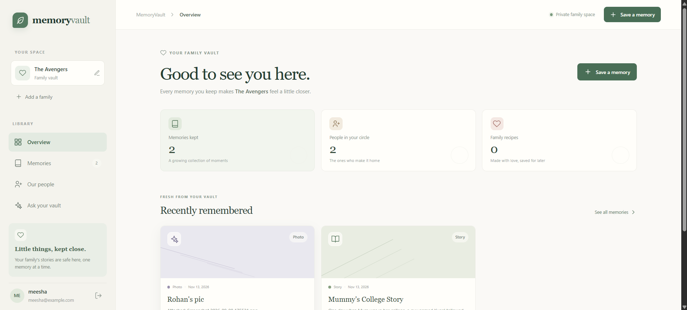
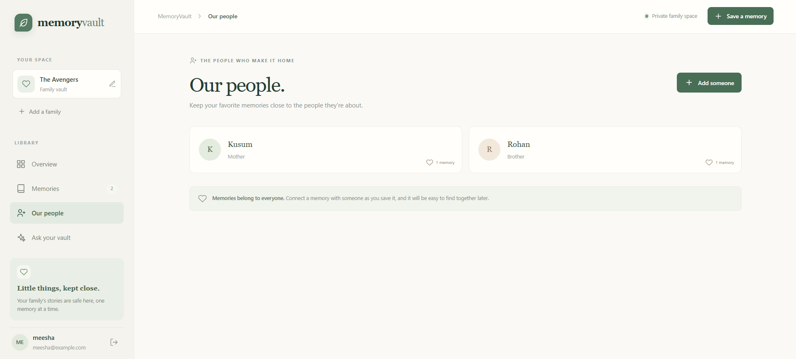
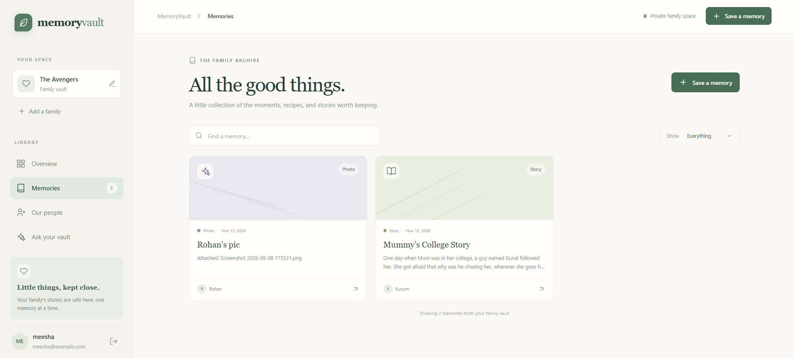
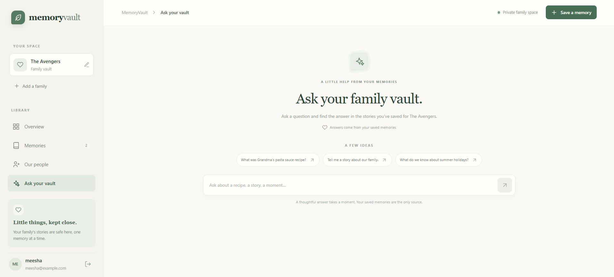
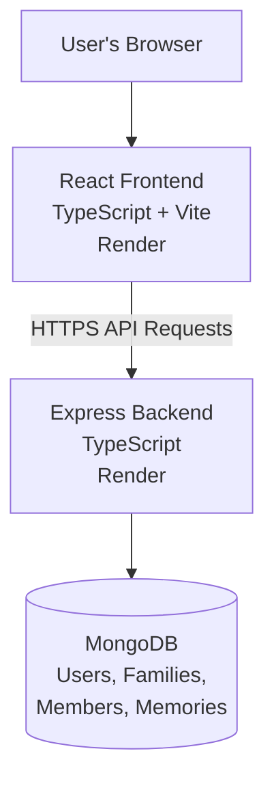
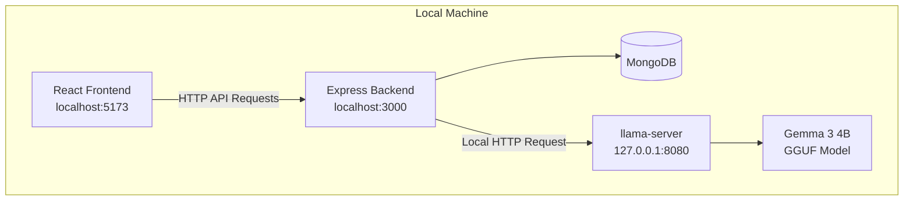
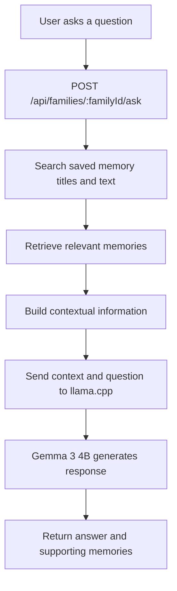

# MemoryVault

**Keep the stories, recipes, and small moments that make your family yours — privately.**

MemoryVault is a privacy-focused family memory application that allows users to preserve stories, recipes, notes, documents, and photos, associate them with family members, and retrieve personal memories through natural-language questions.

Built with **React, TypeScript, Node.js, Express, and MongoDB**, MemoryVault integrates a locally running **Gemma 3 4B model through llama.cpp** to provide AI-powered memory retrieval without requiring an external LLM API.

The project follows a **hybrid deployment architecture**: the frontend and backend are deployed on Render, while AI inference can run locally using an open-weight language model.

---

## 🚀 Live Demo

| Component | Link |
|---|---|
| **Live Application** | [MemoryVault](https://memoryvault-4193.onrender.com) |
| Backend API | [API Endpoint](https://memoryvault-m4xy.onrender.com) |
| Health Check | [API Health](https://memoryvault-m4xy.onrender.com/health) |
| Source Code | [GitHub Repository](https://github.com/Kunal13Kashyap/MemoryVault) |

---

## 📸 Screenshots

### Dashboard



### Family Management



### Memory Management



### Ask Your Vault



---

## ✨ Key Features

### Family & Memory Management
- User registration and authentication.
- Create and manage private family spaces.
- Add and manage family members.
- Associate memories with one or multiple people.
- Organize memories into stories, recipes, notes, documents, and photos.
- Associate memories with yourself, individual family members, or the entire family.

### Attachment Management
- Attach PDF documents to document memories.
- Upload JPEG, PNG, and WebP images.
- Maximum attachment size of 15 MB.
- Download attachments through authenticated API routes.

### Search & Retrieval
- Search and filter saved memories.
- Retrieve relevant memories based on natural-language questions.
- Display supporting memories alongside AI-generated answers.

### Local AI Integration
- Run Gemma 3 4B locally using llama.cpp.
- Use llama.cpp's OpenAI-compatible Chat Completions API.
- Retrieve relevant memory context before generating responses.
- No external hosted LLM API required for local inference.
- Core memory-management functionality remains available when the local AI service is unavailable.

---

## 🏗️ Architecture

MemoryVault consists of three primary components:

- **Frontend:** React + TypeScript application hosted on Render.
- **Backend:** Express + TypeScript REST API hosted on Render.
- **AI Runtime:** Gemma 3 4B running locally through llama.cpp.

### Hosted Application Architecture

The deployed application follows a three-tier architecture consisting of a React frontend, an Express backend, and MongoDB for persistent data storage.



### Local AI Architecture

For local AI inference, the backend and llama.cpp run on the same machine.



**Deployment distinction:** The publicly hosted Render backend cannot directly access a llama.cpp server running on your personal computer through `127.0.0.1`. The local AI configuration described below is intended for running the backend locally alongside the model.

---

## 🧠 How "Ask Your Vault" Works

MemoryVault uses a retrieval-first approach to answer questions about saved memories.



**Current retrieval scope:**
- Memory retrieval uses saved memory titles and text stored in MongoDB.
- Retrieved memories provide context for AI-generated responses.
- Supporting memories are returned alongside the generated answer.
- Uploaded PDF and image contents are not currently parsed or indexed for AI retrieval.

---

## 🛠️ Tech Stack

| Category | Technologies |
|---|---|
| Frontend | React, TypeScript, Vite |
| Styling | Tailwind CSS |
| Animations | Framer Motion |
| Backend | Node.js, Express, TypeScript |
| Database | MongoDB, Mongoose |
| Authentication | Signed Bearer Tokens, Password Hashing |
| AI Model | Gemma 3 4B |
| Model Format | GGUF |
| AI Runtime | llama.cpp |
| Inference Server | llama-server |
| AI Communication | OpenAI-compatible Chat Completions API |
| Deployment | Render |

---

## 🚀 Getting Started

### Prerequisites

For local development:

- Node.js 22 LTS (recommended)
- npm
- Git
- MongoDB

For local AI inference:

- llama.cpp
- Gemma 3 4B instruction-tuned GGUF model
- Sufficient system resources for the selected model quantization

### 1. Clone the Repository

```powershell
git clone https://github.com/Kunal13Kashyap/MemoryVault.git

cd MemoryVault
```

### 2. Configure MongoDB

Start your MongoDB instance.

For a local installation:

```env
MONGODB_URL=mongodb://127.0.0.1:27017/memoryvault
```

A remote MongoDB connection string can also be used.

### 3. Configure the Backend

```powershell
cd server

Copy-Item .env.example .env

npm install
```

Configure `server/.env`:

```env
PORT=3000
MONGODB_URL=mongodb://127.0.0.1:27017/memoryvault
JWT_SECRET=your-random-secret-at-least-32-characters
CLIENT_ORIGIN=http://localhost:5173
```

Generate a unique, strong JWT secret.

### 4. Start the Backend

```powershell
npm run dev
```

Backend:

`http://localhost:3000`

Health check:

`http://localhost:3000/health`

### 5. Configure and Start the Frontend

Open another terminal from the repository root:

```powershell
cd client

npm install

npm run dev
```

Frontend:

`http://localhost:5173`

During local development, Vite proxies API requests to the backend.

If the backend runs on a different origin, configure:

```env
VITE_API_PROXY_TARGET=http://localhost:3000
```

For a separately deployed backend:

```env
VITE_API_URL=https://your-api-origin
```

---

## 🦙 Local AI Setup — Gemma 3 4B + llama.cpp

MemoryVault uses llama.cpp as its local inference runtime and Gemma 3 4B as its language model.

### 1. Install llama.cpp

Follow the official installation instructions:

- [llama.cpp — GitHub](https://github.com/ggml-org/llama.cpp)

Make sure the `llama-server` executable is available on your system.

### 2. Download Gemma 3 4B GGUF

Download a compatible Gemma 3 4B instruction-tuned GGUF model from a trusted model repository.

For example:

```text
gemma-3-4b-it-Q4_K_M.gguf
```

Choose a quantization appropriate for your hardware and ensure the model has a compatible chat template.

### 3. Start llama-server

On Windows PowerShell:

```powershell
llama-server.exe `
  -m "C:\path\to\gemma-3-4b-it-Q4_K_M.gguf" `
  --host 127.0.0.1 `
  --port 8080 `
  --alias gemma-3-4b-it
```

Replace the model path with the actual location of your downloaded GGUF file.

The local inference API will be available at:

```text
http://127.0.0.1:8080/v1
```

### 4. Configure the Backend

Add the following to `server/.env`:

```env
LLAMA_CPP_BASE_URL=http://127.0.0.1:8080/v1
LLAMA_CPP_MODEL=gemma-3-4b-it
```

If your llama.cpp server requires an API key:

```env
LLAMA_CPP_API_KEY=your-local-api-key
```

The configured model name must match the alias supplied when starting llama-server.

Restart the backend after updating environment variables.

### 5. Verify the Model Server

Check the model endpoint:

```text
http://127.0.0.1:8080/v1/models
```

Once the model server is running, open MemoryVault locally and try **Ask Your Vault**.

> Keep llama-server bound to `127.0.0.1`. Do not expose the inference endpoint directly to the public internet.

---

## ☁️ Deployment

MemoryVault's frontend and backend are deployed as separate services on **Render**.

### Frontend Configuration

```env
VITE_API_URL=https://memoryvault-m4xy.onrender.com
```

### Backend Configuration

Configure the backend environment variables:

```env
MONGODB_URL=your-production-mongodb-connection-string
JWT_SECRET=your-production-secret
CLIENT_ORIGIN=https://memoryvault-4193.onrender.com
```

Configure the service port according to the Render deployment settings.

### Deployment Considerations

- Backend CORS must allow the deployed frontend origin.
- Use a persistent MongoDB database.
- Uploaded attachments currently use backend filesystem storage.
- Render's ephemeral filesystem should not be treated as permanent attachment storage.
- Use a persistent disk or object storage for durable production attachments.
- The hosted Render backend does not automatically connect to the locally running llama.cpp server.

---

## 🔌 API Overview

Authenticated endpoints require a valid bearer token.

```http
Authorization: Bearer <token>
```

| Method | Endpoint | Description |
|---|---|---|
| GET | `/health` | API health check |
| POST | `/api/auth/register` | Register a user |
| POST | `/api/auth/login` | Authenticate a user |
| GET | `/api/auth/me` | Retrieve current account |
| GET, POST | `/api/families` | List or create families |
| GET, PATCH | `/api/families/:familyId` | Retrieve or rename a family |
| GET, POST | `/api/families/:familyId/members` | List or add members |
| PATCH, DELETE | `/api/families/:familyId/members/:memberId` | Update or remove a member |
| GET, POST | `/api/families/:familyId/memories` | List or create memories |
| POST | `/api/families/:familyId/ask` | Ask questions about memories |
| GET, PATCH, DELETE | `/api/memories/:memoryId` | Retrieve, update, or delete a memory |
| GET | `/api/memories/:memoryId/attachment` | Download an attachment |

---

## ⚠️ Current Limitations

- Attachments are stored on the backend filesystem rather than dedicated object storage.
- Each document or photo memory supports one attachment.
- Documents must be PDFs; photos must be JPEG, PNG, or WebP.
- Maximum attachment size is 15 MB.
- AI retrieval currently uses saved memory titles and text.
- PDF and image contents are not currently parsed or indexed for AI retrieval.
- Ask Your Vault requires an accessible llama.cpp server.
- AI response quality depends on model quantization, context, and available hardware.
- Attachments may not persist across Render restarts or redeployments without persistent storage.

---

## 🔮 Future Improvements

- Semantic and vector-based memory retrieval.
- PDF parsing and indexing.
- Image understanding for photo memories.
- Streaming AI responses.
- Improved memory ranking and source attribution.
- Persistent attachment storage.
- Expanded automated test coverage.

---

## 📜 License

**Copyright © 2026 Kunal Kashyap. All rights reserved.**

This repository is publicly available for viewing and educational evaluation purposes only. Reproduction, modification, redistribution, or commercial use without prior written permission is prohibited.

---

**Built with ❤️ to preserve the memories that matter.**